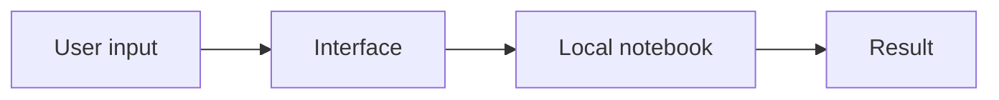
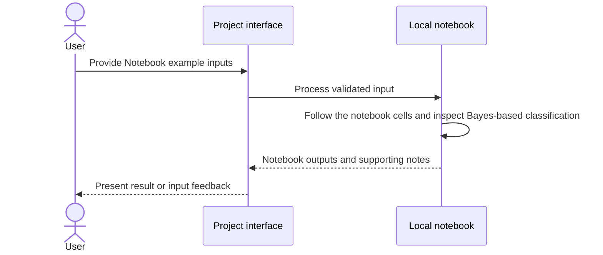
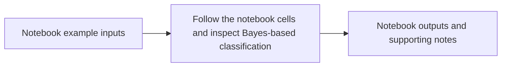

# Naive Bayes Notebook

## 1. Project overview

Run the upstream Naive Bayes learning notebook and inspect its underlying probability assumptions. This repository is a fork of [sunnysavita10/NLP-With-Machine-Learning](https://github.com/sunnysavita10/NLP-With-Machine-Learning).

[Source repository](https://github.com/subhashdixit/Naive-Bayes)

## 2. Motivation and problem statement

### Objective

Run the upstream Naive Bayes learning notebook and inspect its underlying probability assumptions.

### Problem statement

A classifier can look like a black box when the probability rule and conditional-independence assumption are hidden.

### Motivation

A reproducible notebook makes the method and its assumptions easier to study.

## 3. Solution and scope

**Inputs** — Notebook example inputs. **Outputs** — Notebook outputs and supporting notes.

The checked-in example follows the upstream project. It is included here as a runnable reference. [Upstream source](https://github.com/sunnysavita10/NLP-With-Machine-Learning)

## 4. Quick start and usage

Start with the documented sample or supported input. Review the output and any validation feedback. Use the local setup below.

## 5. High-level architecture

## 6. End-to-end request workflow

## 7. Data sources, inputs, and outputs

| Input | Processing | Output |
| --- | --- | --- |
| Notebook example inputs | Follow the notebook cells and inspect Bayes-based classification | Notebook outputs and supporting notes |

## 8. Data flow and ETL pipeline

## 9. Low-level design and interfaces

Open [`Naive Bayes.ipynb`](<Naive%20Bayes.ipynb>) to inspect the sequence of cells and the data contract.

## 10. Concepts and algorithms

- **Bayes rule**. Combine a class prior with feature evidence.
- **Conditional independence**. Naive Bayes factors feature likelihoods conditional on the class, an assumption to consider when interpreting the output.

## 11. Technology choices and dependencies

- **Python and Jupyter**. Run and inspect the original exercise one cell at a time.

## 12. Training, inference, and evaluation

Review behavior using the checked-in fixtures and assertions. This application has no project-trained model benchmark.

## 13. Limitations and data handling

Use the project within the scope of its documented inputs, datasets, and evaluation.

## 14. Installation and local setup

Clone [this fork](https://github.com/subhashdixit/Naive-Bayes) and start a Python environment with Jupyter. Open the notebook listed above. Install the dependencies referenced by its imports before running cells.

## 15. Repository structure

- [`Naive Bayes.ipynb`](<Naive%20Bayes.ipynb>)
- [`naive-bayes.pdf`](<naive-bayes.pdf>)

## 16. Deployment and operations

Run the exercise locally. The repository does not document a maintained deployment.

## 17. License, credits, and support

[Repository code license](LICENSE). Original project attribution is recorded at [sunnysavita10/NLP-With-Machine-Learning](https://github.com/sunnysavita10/NLP-With-Machine-Learning).
